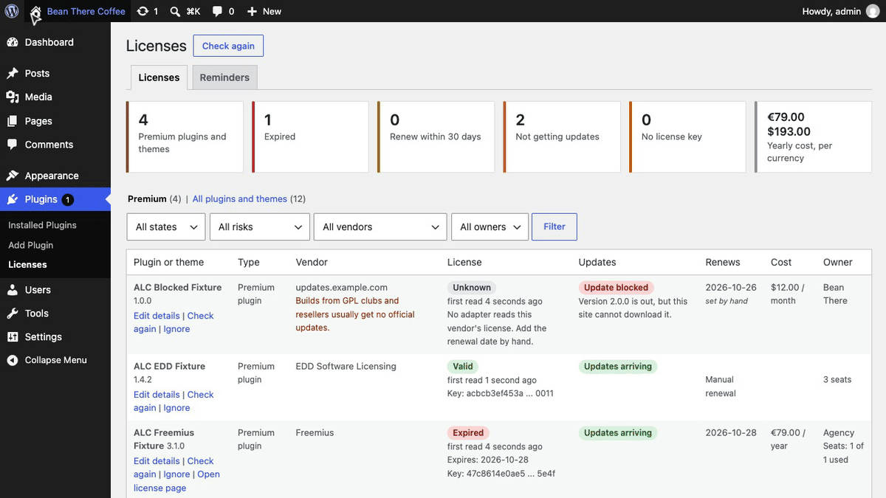
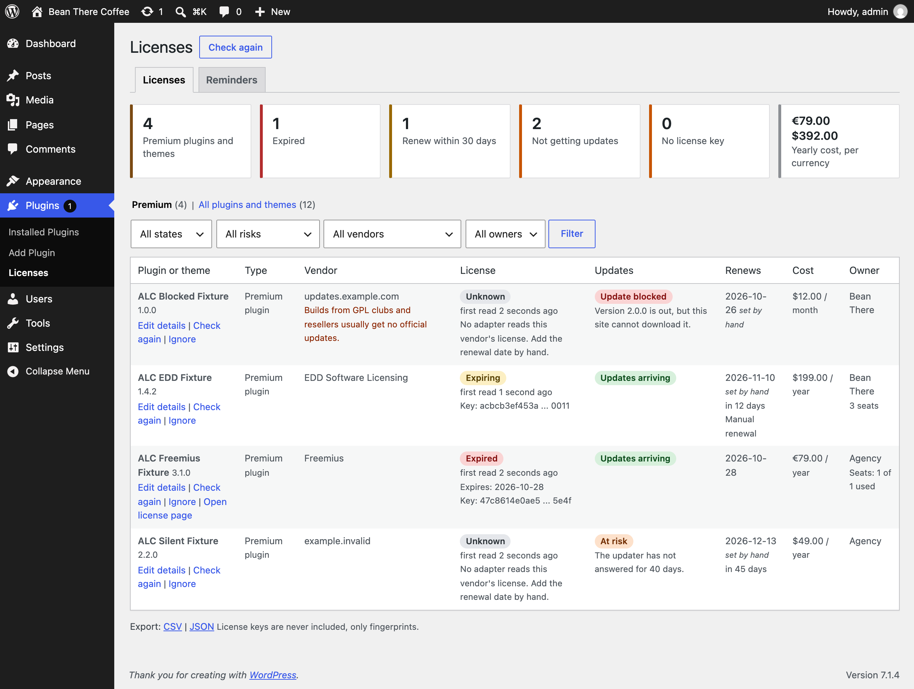
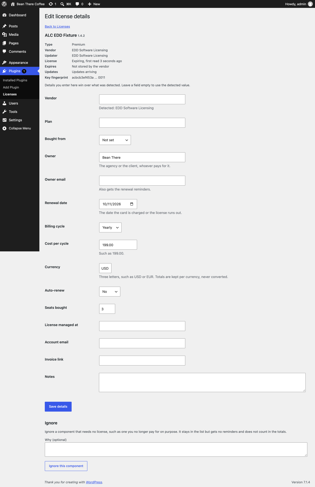
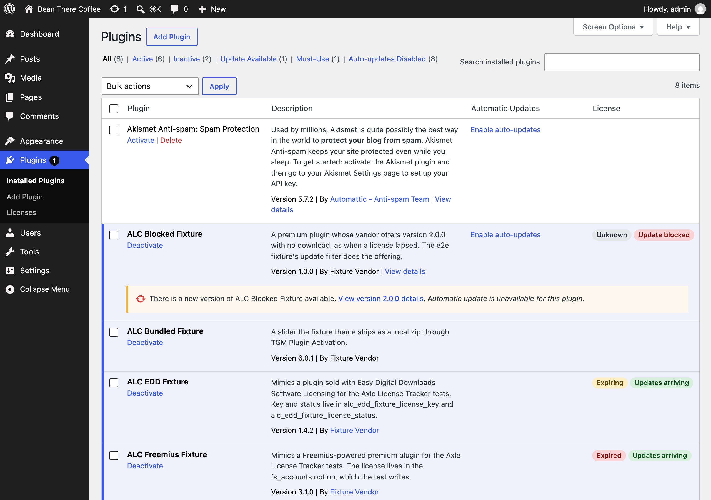
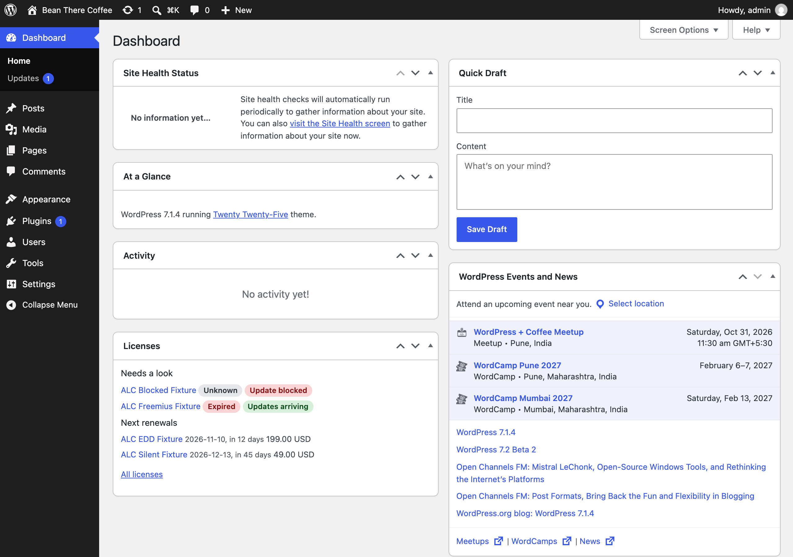

<p align="center"></p>

<h1 align="center">Axle License Tracker</h1>

<p align="center">
  <a href="https://playground.wordpress.net/?blueprint-url=https://raw.githubusercontent.com/aryanjasala/axle-license-tracker/main/blueprint.json"></a>
  <a href="https://github.com/aryanjasala/axle-license-tracker/releases/latest"></a>
  
  
  <a href="LICENSE.md"></a>
  <br>
  <a href="https://github.com/aryanjasala/axle-license-tracker/actions/workflows/phpcs.yml"></a>
  <a href="https://github.com/aryanjasala/axle-license-tracker/actions/workflows/phpstan.yml"></a>
  <a href="https://github.com/aryanjasala/axle-license-tracker/actions/workflows/unit-tests.yml"></a>
  <a href="https://github.com/aryanjasala/axle-license-tracker/actions/workflows/e2e-tests.yml"></a>
  <a href="https://github.com/aryanjasala/axle-license-tracker/actions/workflows/plugin-check.yml"></a>
</p>

<p align="center">See which premium plugins and themes are licensed, which lapsed, which stopped getting updates, and what renews when.</p>

<p align="center">
   Licenses: an expired license and a blocked update, then a renewal date and cost added by hand" width="880">
</p>

---

A typical client site runs 5 to 15 paid plugins and a paid theme, each with its own license screen and its own renewal email, sent to whoever bought it. When a license lapses, updates stop, WordPress mostly says nothing, and security scanners that compare versions with WordPress.org skip premium plugins. Axle License Tracker lists every premium plugin and theme under **Plugins > Licenses** with its license state and how old that is, whether updates actually arrive, the renewal date, the cost and the owner. It only reads what is already on the site: it never activates, checks or changes a key.

> [!NOTE]
> Free and open source under the GPL. No pro version, no upsells, no ads in wp-admin, no tracking. And it stays that way.
>
> Part of Axle by AryanX, a family of plugins for running WordPress sites safely.

## Features

- **Finds the premium ones**: WordPress.org plugins are recognised from the update data WordPress already has. Premium ones from an `Update URI` header, a vendor updater in the update data, an updater or licensing SDK in their code (Freemius, EDD Software Licensing, Plugin Update Checker, WooCommerce API Manager, StellarWP Uplink, SureCart, Appsero, Brainstorm Force) or a known vendor. Plugins a theme ships through TGM Plugin Activation are marked bundled
- **Reads license state without touching it**: built-in readers for Freemius, EDD Software Licensing, WooCommerce.com, Elementor Pro, ACF PRO, Gravity Forms and Envato Market. No vendor code runs, no request goes out, no seat is used. Every state says how old it is
- **Update risk**: blocked when a newer version is out but cannot be downloaded, at risk when the vendor knows a newer version the site is not offered or the updater has been silent for 30 days, watch for a version unchanged for 180 days
- **Renewals and costs**: renewal date, cost and currency (stored in minor units, never converted), billing cycle, owner, seats, account and invoice links. What you enter wins, and the list shows which values were set by hand
- **Reminders**: 30, 14, 7 and 1 days before a renewal date, each sent once, plus an email when a license expires or an update is blocked, and an optional monthly digest
- **Everywhere you look**: a License column on Plugins, a dashboard widget with the next renewals, and a Site Health check that goes critical when an update is blocked
- **Keys stay on the site**: never stored, shown, sent or logged. Only a fingerprint (a 12-character hash prefix and the last 4 characters) to spot one license used on several sites
- **For agencies**: a read-only REST report and a License reporter role that can read it and nothing else
- **WP-CLI** for everything (`scan` exits 1 for monitoring), **abilities** for AI agents, CSV and JSON export, and privacy export and erase

## Install

1. Download `axle-license-tracker.zip` from the [latest release](https://github.com/aryanjasala/axle-license-tracker/releases/latest).
2. In WordPress, go to **Plugins > Add New Plugin > Upload Plugin**, choose the zip and activate it.

Or with WP-CLI:

```sh
wp plugin install https://github.com/aryanjasala/axle-license-tracker/releases/latest/download/axle-license-tracker.zip --activate
```

Needs WordPress 6.6+ and PHP 7.4+. To try it first, the **Try in WordPress Playground** badge opens a throwaway WordPress in your browser with the plugin and some demo content.

## Quick look

```sh
wp axle-license-tracker scan
# 4 premium: 1 expired, 1 expiring, 0 missing a key, 2 not getting updates (1 blocked).
# - ALC Blocked Fixture: unknown, blocked

wp axle-license-tracker list --risk=at-risk
wp axle-license-tracker set plugin:elementor-pro/elementor-pro.php --renewal=2027-03-01 --cost=59 --currency=USD --cycle=yearly --owner="Bean There"
wp axle-license-tracker expiring --days=30
wp axle-license-tracker remind --dry-run
```

Or open **Plugins > Licenses**.

## Screenshots

<table>
  <tr>
    <td width="50%" valign="top"> Licenses: license state and age, update risk, renewal dates, costs per currency and owners"><br><sub>Plugins > Licenses: license state and age, update risk, renewal dates, costs per currency and owners</sub></td>
    <td width="50%" valign="top"><br><sub>Editing the details detection cannot know, next to what was detected</sub></td>
  </tr>
  <tr>
    <td width="50%" valign="top"><br><sub>The License column on the Plugins screen</sub></td>
    <td width="50%" valign="top"><br><sub>The dashboard widget: what needs a look and the next renewals</sub></td>
  </tr>
</table>

## Documentation

| Doc | What it covers |
| --- | --- |
| [Reference](docs/REFERENCE.md) | Detection layers, adapters, update risk, reminders, hooks, the adapter API, abilities, REST, WP-CLI, data and privacy |
| [Development](docs/DEVELOPMENT.md) | Local setup, commands and tests |
| [Contributing](docs/CONTRIBUTING.md) | Pull requests, required checks and PR titles |
| [Releasing](docs/RELEASING.md) | How merged pull requests become releases |
| [Security](docs/SECURITY.md) | Reporting a vulnerability |
| [readme.txt](readme.txt) | What WordPress.org shows, with the FAQ and changelog |

## Project structure

```
axle-license-tracker.php  plugin header and PSR-4 autoloader
data/
├── signatures.json      updater and SDK signatures for the scan
└── vendors.json         known vendors
src/
├── Plugin.php           creates the services
├── Inventory.php        installed plugins and themes
├── Updates.php          the update transients, and when updaters answered
├── Scanner.php          the bounded code scan
├── Classifier.php       directory, premium, bundled, custom
├── Adapters/            the seven license readers
├── Risk.php             update risk
├── Tracker.php          one row per component, and syncing
├── Licenses.php         alc_license records
├── Details.php          details entered by hand
├── Reminders.php        reminders, alerts and the digest
├── Report.php           the report, Export.php CSV and JSON
├── Rest/                the read-only report route
├── Abilities.php        abilities for agents
├── Privacy.php          export, erase and policy text
├── Health/SiteHealth.php the Site Health check
├── Admin/               Plugins > Licenses, the column, the widget
└── Cli/Command.php      wp axle-license-tracker
assets/                  admin.css, admin.js
tests/
├── Unit/                PHPUnit
└── e2e/                 Playwright specs, fixtures and the Docker site
docs/                    reference, development, contributing, releasing
```

## More free plugins

Small plugins that each fill one gap in WordPress, all free with no pro version:

| | Plugin | What it does |
| --- | --- | --- |
|  | [Page Template Usage](https://github.com/aryanjasala/page-template-usage) | See which template every page uses, and fix the pages on a missing template |
|  | [Staging Guard](https://github.com/aryanjasala/staging-guard) | Stops staging copies from emailing real people or getting indexed |
|  | [Category & Tag Trash](https://github.com/aryanjasala/category-tag-trash) | A trash for categories, tags and custom terms, with undo and full restore |
|  | [Axle Read-Only Mode](https://github.com/aryanjasala/axle-read-only-mode) | Read-only mode for WordPress during migrations and deploys |
|  | [Restore Blocks from Revisions](https://github.com/aryanjasala/restore-blocks-from-revisions) | Restore a single block from an old revision, not the whole post |
|  | [Activity Log with Undo](https://github.com/aryanjasala/activity-log-with-undo) | An activity log where every change you can reverse has an Undo button |
|  | [Agent Governance](https://github.com/aryanjasala/agent-governance) | Hold risky AI agent calls for approval, preview what they change, and roll back a session |
|  | [Block Doctor](https://github.com/aryanjasala/block-doctor) | Scan the whole site for invalid and broken blocks and fix them in bulk, with undo |
|  | [Block Theme Ops](https://github.com/aryanjasala/block-theme-ops) | Find Site Editor changes that override your theme files, see the diff, reset them or send them to Git |
|  | [Role Right-Sizer](https://github.com/aryanjasala/role-right-sizer) | Recommends the smallest role each user needs, from what they actually do |
|  | [Update Rehearsal](https://github.com/aryanjasala/update-rehearsal) | Try plugin, theme, core and PHP updates on a disposable copy of your site in WordPress Playground first |
|  | [User Session Manager](https://github.com/aryanjasala/user-session-manager) | See every device signed in, sign out one, and limit sessions per role |

## License

Copyright Aryan Jasala. Licensed under [GPL-2.0-or-later](LICENSE.md).
